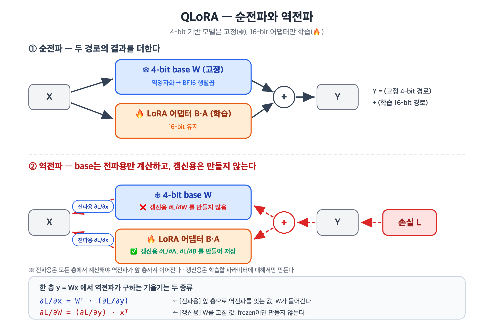
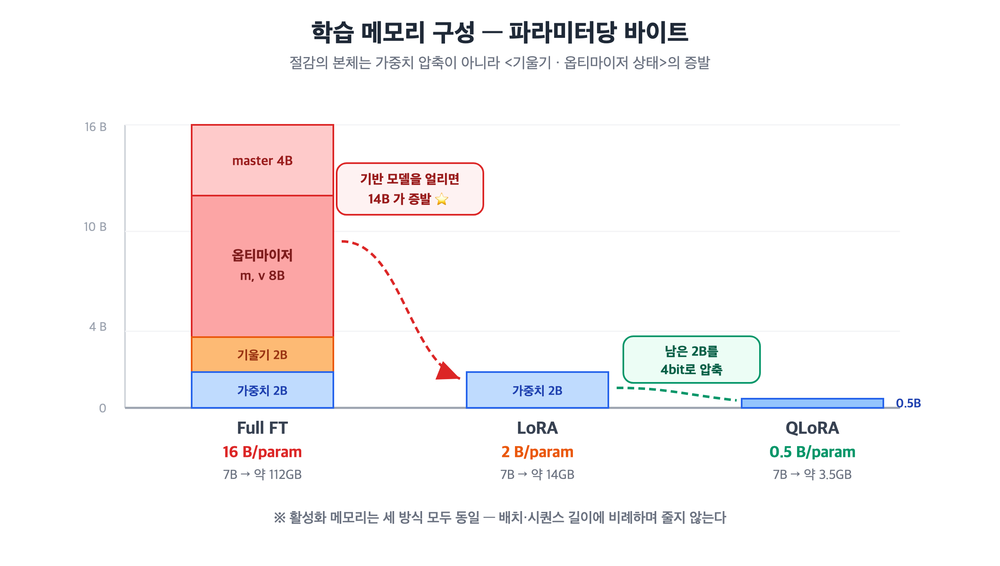

<!-- 📝 글 소개 (출간 시 입력): QLoRA가 4-bit 양자화 모델 위에서 LoRA 어댑터를 학습하는 구조와, 전체 파인튜닝 대비 메모리·비용이 줄어드는 원리 -->

# QLoRA — 양자화된 LLM 위에서 어댑터를 학습하는 구조와 메모리 절감 원리

> **딥다이브 주제:** QLoRA가 양자화된 LLM 위에서 LoRA Adapter를 학습하는 구조를 설명하고, 전체 파인튜닝 대비 학습 메모리와 비용을 줄일 수 있는 원리를 분석하시오

---

## 들어가며 — 7B 모델인데 왜 24GB GPU에서 OOM이 날까

"7B 모델은 FP16으로 14GB니까 24GB GPU면 충분하겠지"라고 생각하기 쉽다. 하지만 학습하려고 하면 메모리가 터진다.

**학습에 드는 메모리는 가중치만이 아니기 때문**이다.

```
학습 메모리 = 가중치 + 기울기 + 옵티마이저 상태 + 활성화
 (7B 기준)    14GB     14GB       ~84GB        배치에 비례
```

| 항목 | 무엇인가 |
|---|---|
| **기울기** | 각 가중치를 얼마나 고칠지 나타내는 값 — 가중치와 **개수가 같다** |
| **옵티마이저 상태** | AdamW가 가중치마다 들고 다니는 기록 두 개(`m`, `v`) — 역시 **개수가 같다** |
| **활성화** | 순전파 중 각 층이 뱉은 중간 출력. 역전파 때 필요해 저장해둔다 |

**가중치는 전체의 1/8도 안 된다.** 진짜 덩어리는 기울기와 옵티마이저 상태다.

QLoRA가 메모리를 줄이는 원리는 "가중치를 4비트로 눌러서"가 아니다. **저 14GB와 84GB를 통째로 없애는 것**에서 시작한다.

---

## 1. LoRA — 무엇을 학습하는가

파인튜닝이란 결국 가중치를 이렇게 바꾸는 것이다.

```
W_새로운 = W_원본 + ΔW      ← ΔW = "이 작업에 맞게 바뀌어야 할 변화량"
```

Full Fine-Tuning은 `W_새로운`을 통째로 다시 계산한다. LoRA는 관점을 바꾼다.

> **원본 `W`는 건드리지 말고, 변화량 `ΔW`만 따로 학습하자.**
> 그것도 통짜로 말고, **작은 두 행렬의 곱 `B×A`로 근사**해서.

그래서 순전파 출력은 이렇게 된다.

```
h = W×x + B×A×x
  = (W + BA)×x        ← 묶으면 이게 곧 "파인튜닝된 가중치"
```

원본을 안 건드렸을 뿐, 모델의 실제 동작은 `W + BA`가 결정한다. 학습으로 `A`, `B`를 갱신하면 **원하는 방향으로 파인튜닝된다.**

`4096×4096` 가중치에 `rank=16`이면 학습 파라미터는 약 **0.78%**뿐이다.

> **핵심:** 학습 대상이 줄면 **거기에 딸린 기울기·옵티마이저 상태도 함께 준다.** 메모리 이득의 출발점이 여기다.

---

## 2. QLoRA의 구조

### 2-1. 4-bit는 "저장", 계산은 16-bit

가장 흔한 오해부터 정리하자. **4-bit로 저장했다고 4-bit로 곱셈하는 게 아니다.**

| | 저장 (GPU 메모리에 앉아있는 형태) | 계산 (행렬곱할 때) |
|---|---|---|
| **W (기반 모델)** | **NF4 (4-bit)** ← 절감 지점 | BF16 (풀어서) |
| **A, B (어댑터)** | BF16 (16-bit) | BF16 |

GPU는 4-bit 행렬곱을 하지 않는다. 그래서 **행렬곱 직전에 지금 필요한 블록만 BF16으로 풀고, 쓰고, 버린다.** 전체를 한꺼번에 풀면 결국 14GB가 되어 의미가 없기 때문이다. 이것을 **on-the-fly 역양자화**라 한다.

대가는 **속도**다. 매번 압축을 푸는 연산이 추가된다.

> **왜 `W`만 4-bit로 눌러도 되나?** `W`는 학습 내내 **절대 바뀌지 않으니까**(frozen), 정밀도가 낮아도 오차가 누적될 일이 없다. 반면 `A`, `B`는 매 스텝 조금씩 갱신되므로 4-bit로 두면 **작은 업데이트가 반올림에 묻혀 사라진다.** 그래서 어댑터는 16-bit를 유지한다.

### 2-2. 역전파 — 무엇을 계산하고 무엇을 계산하지 않는가 ⭐

여기가 "양자화된 모델 **위에서** 학습한다"는 말의 실체다.




| | 수식 | 무엇에 대한 기울기 | 역할 | 식에 필요한 것 |
|---|---|---|---|---|
| **전파용** | `∂L/∂x = Wᵀ · g` | 이 층의 **입력 `x`** | 앞 층으로 역전파를 **이어간다** (앞 층의 `g`가 됨) | **`W`** |
| **갱신용** | `∂L/∂W = g · xᵀ` | 이 층의 **가중치 `W`** | 옵티마이저가 **`W`를 고치는 데** 쓴다 | **`x`** |

- **전파용**을 계산하지 않으면 **역전파가 그 층에서 끊긴다** → 모든 층에서 계산해야 한다
- **갱신용**을 계산하지 않으면 **그 파라미터가 학습되지 않는다** → **학습할 파라미터에 대해서만** 계산한다

---

## 3. 메모리·비용 절감 원리

### 3-1. 파라미터당 바이트로 분해하기



| 구성요소 | Full FT | LoRA | QLoRA |
|---|---|---|---|
| 모델 가중치 | 2 B (FP16) | 2 B (FP16) | **0.5 B (NF4)** |
| 기울기 | 2 B | **0** | **0** |
| 옵티마이저 `m`, `v` | 8 B | **0** | **0** |
| FP32 master weight | 4 B | **0** | **0** |
| **합계** | **~16 B/param** | **~2 B/param** | **~0.5 B/param** |

> 기울기·옵티마이저가 `0`인 이유는 **기반 모델이 frozen**이기 때문이다. 어댑터(전체의 1% 미만)에 대해서만 따로 필요하며, 이는 수십 MB 수준이다.

7B 모델에 대입하면:

| 방식 | 기반 모델분 (7B) | 무엇이 줄었나 |
|---|---|---|
| Full FT | 약 **112GB** | — |
| LoRA | 약 **14GB** | **기울기·옵티마이저 상태 증발** (14 B/param) |
| QLoRA | 약 **3.5GB** | 위 + **가중치 압축** (2 B → 0.5 B) |

### 3-2. 절감의 본체는 "옵티마이저 상태의 증발"

가장 자주 오해되는 지점이다.

> QLoRA의 메모리 이점은 **"가중치를 4bit로 눌러서"가 주된 이유가 아니다.**
> **고정된 기반 모델에 기울기와 옵티마이저 상태가 아예 존재하지 않게 된 것**이 가장 크다.

파라미터당 16바이트 중 **가중치는 2바이트뿐**이고, 나머지 14바이트가 기울기·옵티마이저·master weight다. **LoRA만 써도 이 14바이트가 사라진다.** QLoRA는 여기서 남은 2바이트를 0.5바이트로 더 줄인다.

**LoRA가 큰 계단, QLoRA가 그 위의 작은 계단**이다. 다만 모델이 커질수록 4배 압축의 절대량이 커져 QLoRA의 기여도 함께 커진다.


### 3-3. 비용의 이중성 — 메모리는 줄지만 속도는 느려진다

QLoRA는 공짜가 아니다. **메모리를 시간과 맞바꾼다.**

| 항목 | 변화 |
|---|---|
| 메모리 | 크게 감소 ✅ |
| 속도 | **감소** ❌ |

느려지는 이유는 두 가지다.
- 압축 해제가 **순전파에서 한 번, 역전파에서 또 한 번** 일어난다 (전파용 기울기 `Wᵀ·g` 계산에도 `W`가 필요하므로)

그런데 실제 **비용 = GPU 시간 × GPU 단가**다. 여기서 반전이 생긴다.

- 속도가 감소해도, 메모리가 줄어 **더 싸고 작은 GPU에 올릴 수 있으면** 총비용은 내려간다
- 더 중요한 건 **"불가능을 가능으로"** 바꾸는 것이다 — 논문은 **65B 모델을 단일 48GB GPU에서** 파인튜닝했다. 16-bit Full FT라면 **780GB 이상**이 필요해 시도조차 못 한다

---

---

## 결론

QLoRA의 구조는 **"고정된 4-bit 기반 모델 + 학습되는 16-bit 어댑터"** 한 줄로 요약된다. 역전파는 기반 모델에 대해 **전파용 기울기만 계산하고, 갱신용 기울기는 만들지 않는다.**

메모리가 줄어드는 원리는 두 계단이다.

1. **기울기·옵티마이저 상태의 증발** (LoRA에서 옴) — 파라미터당 16바이트 중 **14바이트**가 사라진다. **절감의 본체**
2. **가중치 4-bit 압축** (QLoRA의 추가분) — 남은 2바이트를 0.5바이트로

그 대가로 **역양자화·재계산 오버헤드만큼 느려지고**, **활성화 메모리는 그대로** 남아 gradient checkpointing으로 따로 대응해야 한다.

> QLoRA의 진짜 가치는 "빨라진다"가 아니라, **원래는 올릴 수조차 없던 크기의 모델을 GPU 한 장에 올려 학습 가능하게 만든다**는 데 있다.
