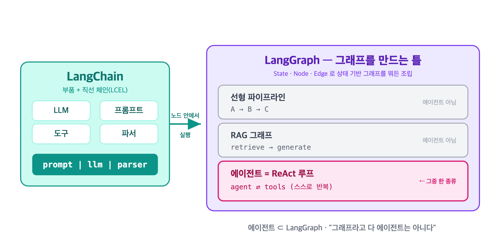
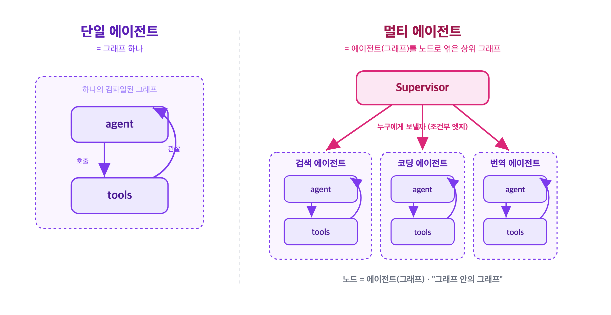

<!-- 📝 글 소개 (출간 시 입력): LangGraph·에이전트·LangChain·멀티에이전트가 서로 어떤 관계인지 한 번에 정리 -->

# LangGraph와 에이전트 — 개념 관계 한 번에 정리

딥다이브 내용을 서로 공유하며 나온 질문들을 따라, **LangGraph · 에이전트 · LangChain · 멀티에이전트**가 어떻게 맞물리는지 정리한 노트다. 하나씩 "이게 뭘 하는 거냐"를 따라가면 네 개념이 층층이 쌓인다.

---

## 1. LangGraph와 에이전트의 관계

**LangGraph는 그래프를 만드는 틀이고, 에이전트는 그 틀로 만든 그래프의 한 종류다** (에이전트 ⊂ LangGraph).

- **LangGraph** = State·Node·Edge로 **상태 기반 그래프를 뭐든 만드는 틀(프레임워크)**. 에이전트 전용이 아니라 분기 없는 선형 파이프라인도, RAG도 만든다.
- **에이전트** = 그 틀로 만든 **특정 모양의 그래프 하나** — "LLM이 추론→도구호출→관찰을 스스로 반복하는 루프". LangGraph의 여러 활용 사례 중 하나다.



만들어진 에이전트 하나는 실제로 컴파일된 그래프(`CompiledStateGraph`)다. 반대로 모든 그래프가 에이전트인 것은 아니다 — 에이전트이려면 **LLM이 루프를 돌며 스스로 도구를 반복 호출**하는 구조여야 한다.

### 네 개념이 층층이 쌓인다

| 층 | 개념 | 역할 |
|---|---|---|
| ① | **StateGraph** | State + Node + Edge — LangGraph의 토대 |
| ② | **Conditional Edges** | State를 보고 다음 노드 결정 — 동적 분기·루프 |
| ③ | **ReAct** | agent↔tools 순환 — ②로 만든 에이전트 패턴 |
| ④ | **create_agent** | 그 패턴을 자동 배선 — ③을 한 줄로 찍는 팩토리 |

> 에이전트는 **"조건부 엣지로 루프를 만든 LangGraph 그래프의 한 종류"** 다.

---

## 2. 에이전트의 역할 — 무엇을 하는가

에이전트의 역할을 한마디로 하면 **"목표를 받아, 그걸 이루기까지 필요한 행동(도구 호출)을 스스로 판단해서 반복하는 것"** 이다. 핵심은 **"스스로 판단"** 과 **"반복"** 이다.

| | 하는 일 | 흐름을 누가 정하나 |
|---|---|---|
| LLM 단일 호출 | 질문 → 답 한 번 | 없음 |
| 고정 워크플로우 | 정해진 순서대로 | **개발자**가 미리 배선 |
| **에이전트** | 목표 달성까지 도구 반복 호출 | **LLM이 실행 중에** 스스로 결정 |

에이전트의 진짜 역할은 마지막 줄 — **"다음에 뭘 할지"라는 제어 흐름의 결정권을 LLM에게 넘긴 것**이다.

### 매 턴 하는 일 (ReAct 루프)

```
agent(판단) ──[도구 필요?]──예──▶ tools(실행) ──▶ 결과가 agent로 복귀(관찰)
                  │                                       │
                  └──아니──▶ END                           └─ 다시 판단, 필요하면 또 도구…
```

1. **판단(Reason)** — 목표를 이루려면 지금 뭘 해야 하지?
2. **행동(Act)** — 필요한 도구를 골라 **호출을 요청**
3. **관찰(Observe)** — 도구 결과를 읽고
4. **재판단** — 충분한가? 부족하면 1번으로, 충분하면 **종료**

> 주의: agent 노드는 도구를 **직접 실행하지 않는다.** "이 도구를 이 인자로 불러줘"라는 `tool_calls` **요청만** 만들고, 실제 실행은 **별도의 tools 노드**가 한다. LLM은 텍스트만 생성할 뿐 코드를 못 돌리기 때문이다.

| 노드 | 하는 일 |
|---|---|
| **agent** (LLM) | 판단 → 도구 호출 요청 생성 + 종료 판단 |
| **tools** | 요청받은 함수를 실제 실행 → 결과를 `ToolMessage`로 반환 |

---

## 3. "에이전트를 개발한다" = 그래프 하나를 만드는 것

LangGraph로 에이전트를 개발한다는 건 결국 **State·노드·엣지를 정의하고 `compile()`로 그래프 하나를 찍어내는 것**이다.

```python
builder = StateGraph(MessagesState)            # ① State: 노드끼리 주고받을 공유 노트

builder.add_node("agent", agent)               # ② 노드: 판단 (LLM)
builder.add_node("tools", ToolNode(tools))     #         실행

builder.add_edge(START, "agent")               # ③ 엣지: 흐름 설계
builder.add_conditional_edges("agent", tools_condition, ["tools", END])  # 분기
builder.add_edge("tools", "agent")             #         순환 엣지 = 관찰 피드백

react_agent = builder.compile()                # ④ 컴파일 = 완성된 에이전트
```

| 작성하는 것 | 곧 개발하는 것 |
|---|---|
| State 스키마 | 노드 간 데이터 흐름 |
| 노드 함수들 | 각 단계의 실제 로직 (판단·실행) |
| 엣지·조건부 엣지 | **에이전트의 행동 방식**(루프·분기·종료) |
| compile() | 실행 가능한 그래프 = **에이전트 본체** |

**엣지 설계가 곧 "이 에이전트가 어떻게 행동하는가"** 를 정한다. `agent→tools→agent` 순환을 만들었으니 ReAct 에이전트가 된 것이고, 순환 없이 `agent→END`로만 이었다면 도구 한 번 쓰고 끝나는 그래프가 됐을 것이다.

### 직접 짜기 vs `create_agent`

```python
# create_agent: 노드·엣지 배선을 프레임워크가 자동으로. 재료 3개만 넘기면 됨
react_agent = create_agent(
    model=llm,           # 어떤 LLM (머리)
    tools=[search],      # 어떤 도구 (손발)
    system_prompt="...", # 어떻게 행동할지 (지침)
)
```

| | 누가 그래프를 배선하나 | 언제 |
|---|---|---|
| **StateGraph 직접** | 내가 노드·엣지 다 짬 | 흐름을 세밀하게 제어할 때 |
| **create_agent** | 프레임워크가 자동 | 표준 ReAct면 충분할 때 |

**결과물은 둘 다 똑같이 "컴파일된 그래프 하나"** 다. 차이는 손으로 짰냐, 팩토리가 찍어줬냐일 뿐이다.

---

## 4. LangChain vs LangGraph — 체인은 "노드 안의 일"

LangChain의 한 흐름(체인)은 흔히 **LangGraph 노드 하나의 내부 로직**이 된다.

```python
rag_chain = prompt | llm | parser          # LangChain 체인 (LCEL): 직선 파이프

def generate_node(state):                  # 이 체인이 노드 안에서 돎
    answer = rag_chain.invoke({"question": state["question"]})
    return {"answer": answer}
```

다만 LangChain은 "흐름"만 주는 게 아니라 **부품**도 준다.

| LangChain이 주는 것 | 예 |
|---|---|
| **부품(컴포넌트)** | LLM, 프롬프트, 도구, 파서, 리트리버 |
| **부품을 잇는 문법(LCEL 체인)** | `prompt \| llm \| parser` |

결정적 차이는 **직선 vs 그래프**다. LangChain 체인(LCEL)은 `A | B | C`처럼 앞에서 뒤로 한 방향이라 **상태 누적·루프·조건 분기가 약하다.** 그 직선 체인들을 **되돌아가고(순환)·갈라지고(분기)·기억하게(State)** 만드는 게 LangGraph다.

```
LangChain 체인 = 직선 파이프     prompt → llm → parser
                     │
LangGraph = 직선들을 노드로 삼아 State·조건부 엣지·루프로 엮음
                     │
     node A(체인1) ──조건──▶ node B(체인2) ──루프──▶ ...
```

> 비유: **LangChain 체인 = 조립된 부품 한 덩어리**, **LangGraph = 그 덩어리들을 배선해 움직이게 만든 회로판.**

---

## 5. 멀티 에이전트 — 그래프 안의 그래프

**단일 에이전트 = 그래프 하나**였다면, **멀티 에이전트 = 여러 에이전트(각자 그래프)를 노드로 삼아 더 큰 그래프로 엮은 것**이다.

### 왜 나누는가

에이전트 하나에 도구 수십 개 + "코딩도 검색도 번역도" 프롬프트를 다 몰면 → LLM이 도구 선택을 헷갈리고, 맥락 과부하가 오고, 하나 고치면 다른 게 깨진다. 그래서 **역할별 전문 에이전트로 쪼개고 조율자를 둔다.** 사람 팀 나누듯이.



### LangGraph로 보면 — "노드 = 에이전트"

에이전트 하나가 곧 그래프이므로, 그 그래프를 **더 큰 그래프의 노드로 통째로 집어넣는 것**이 멀티 에이전트다.

```python
research_agent = create_agent(model, tools=[search], ...)   # 각 에이전트 = 그래프
coding_agent   = create_agent(model, tools=[run_code], ...)

supervisor = StateGraph(State)
supervisor.add_node("research", research_agent)   # 노드 = 에이전트(그래프)
supervisor.add_node("coding", coding_agent)
supervisor.add_conditional_edges("supervisor", route_to_agent, [...])  # 누구에게 보낼까
```

| 개념 | 단일 에이전트 | 멀티 에이전트 |
|---|---|---|
| 노드 | 함수 (판단/실행) | **에이전트 하나(그래프)** |
| 조건부 엣지 | 도구 쓸까/끝낼까 | **어느 에이전트에게 보낼까** |
| State | 대화 맥락 누적 | 에이전트 간 공유·전달되는 맥락 |

> 대표 구조: **Supervisor(감독자가 라우팅)**, **Network(에이전트끼리 직접 전달)**, **Hierarchical(감독자 밑에 또 팀)**. 나누면 전문성·유지보수가 좋아지지만 조율 비용·토큰이 늘어, **역할이 뚜렷이 갈릴 때** 쓴다.

---

## 한 장 요약

| 개념 | 한마디 정의 |
|---|---|
| **LangChain** | LLM·도구 같은 **부품**과 이를 잇는 **직선 체인(LCEL)** 을 주는 라이브러리 |
| **LangGraph** | 체인·부품을 노드로 삼아 **State·순환·분기**로 엮는 그래프 오케스트레이션 틀 |
| **에이전트** | LangGraph로 만든 **"LLM이 스스로 도구를 반복 호출하는 특정 그래프"** |
| **create_agent** | 그 표준 에이전트 그래프를 **자동으로 찍어내는 팩토리** |
| **멀티 에이전트** | 전문 에이전트(각자 그래프)를 **노드로 엮어 조율자가 협력시키는 상위 그래프** |

> **핵심 한 줄:** LangChain 체인은 노드 안의 일, LangGraph는 노드를 엮는 틀, 에이전트는 그 틀로 만든 반복 그래프, 멀티에이전트는 그래프를 노드로 다시 엮은 그래프다.
