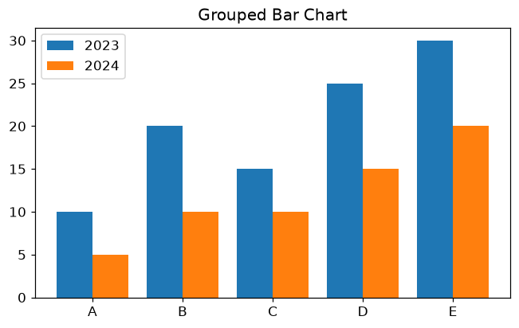
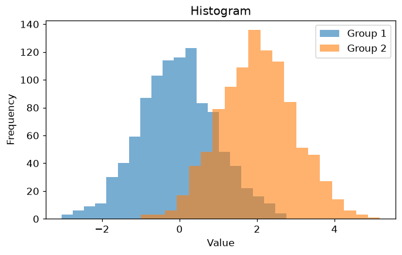
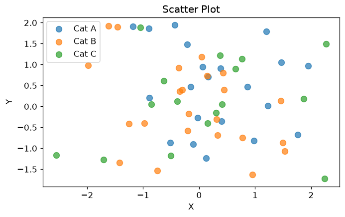
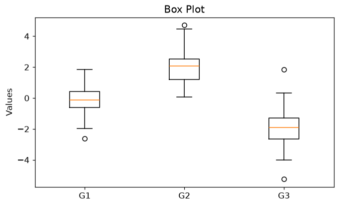
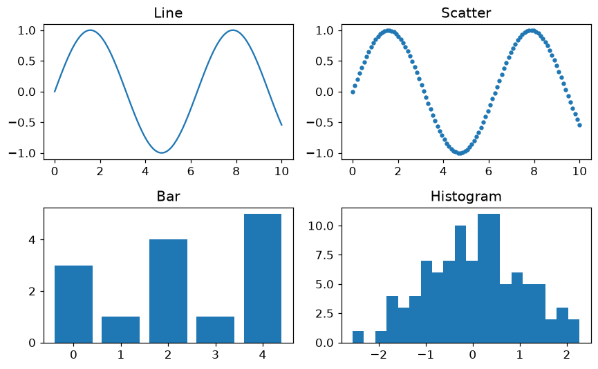

<!-- 📝 글 소개 (출간 시 입력): Matplotlib의 Figure·Axes 구조와 막대·히스토그램·산점도·박스플롯·다중 그래프 정리 -->

# 🎈 Matplotlib

**Matplotlib**은 파이썬에서 차트와 그래프를 만드는 기본 시각화 라이브러리다. MATLAB의 플로팅 기능을 파이썬으로 구현했다.

```python
import matplotlib.pyplot as plt
plt.plot(x, y)
plt.title("Line Graph"); plt.xlabel("X"); plt.ylabel("Y")
plt.show()
```

> `plt.show()`는 스크립트 환경에서 필수지만, Jupyter/Colab에서는 없어도 자동 출력된다.

___

## 📌 Figure와 Axes 구조

Matplotlib을 제대로 쓰려면 **두 개의 그리는 방식**을 구분해야 한다.

- **pyplot 방식** (`plt.plot()`): 현재 그래프에 바로 그림. 간단한 단일 그래프에 적합
- **객체지향 방식** (`fig, ax = plt.subplots()`): <span style="color:red">Figure(전체 도화지) + Axes(개별 그래프)</span>를 직접 다룸. 여러 그래프를 배치할 때 필수

> Figure는 전체 캔버스, Axes는 그 안의 개별 그래프 하나다. 그래프가 여러 개가 되는 순간부터는 객체지향 방식(`ax.plot()`)이 사실상 표준이다.

Pandas의 `df.plot()`은 Matplotlib 기반이라 **한 줄로 빠른 탐색**이 가능하다.

```python
df.plot(x="Month", y=["Sales", "Cost"], kind="line", marker="o")
```

___

## 📌 막대 그래프 (Bar Chart)

범주형 데이터의 크기를 막대 길이로 비교한다.

```python
import matplotlib.pyplot as plt
import numpy as np

categories = ['A', 'B', 'C', 'D', 'E']
values1 = [10, 20, 15, 25, 30]   # 2023
values2 = [5, 10, 10, 15, 20]    # 2024
x = np.arange(len(categories))
width = 0.4

# 그룹형 — 위치를 좌우로 밀어 나란히 배치
plt.bar(x - width/2, values1, width, label='2023')
plt.bar(x + width/2, values2, width, label='2024')
plt.xticks(x, categories)
plt.legend()
plt.title("Grouped Bar Chart")
plt.show()
```



> `plt.barh()`는 가로 막대, `plt.bar(..., bottom=values1)`처럼 `bottom`을 주면 누적형이 된다.

___

## 📌 히스토그램 (Histogram)

연속형 데이터를 **구간(bin)으로 나눠 각 구간의 빈도**를 막대로 표현한다.

```python
import numpy as np
import matplotlib.pyplot as plt

np.random.seed(0)
data1 = np.random.randn(1000)
data2 = np.random.randn(1000) + 2   # 평균을 +2 이동

plt.hist(data1, bins=20, alpha=0.6, label='Group 1')
plt.hist(data2, bins=20, alpha=0.6, label='Group 2')  # alpha로 겹침 표현
plt.xlabel("Value"); plt.ylabel("Frequency")
plt.legend(); plt.title("Histogram")
plt.show()
```



> 막대 그래프는 **범주 비교**, 히스토그램은 **연속형 데이터의 분포 확인**이라는 점이 다르다. `bin`(구간) 수가 너무 많으면 노이즈가, 너무 적으면 패턴이 사라지므로 적절히 조정한다. EDA에서 필수로 쓴다.

___

## 📌 산점도 (Scatter Plot)

두 변수를 좌표 평면에 점으로 찍어 **관계**를 본다. 상관관계 파악, 이상치 탐지, 예측값 vs 실제값 비교에 쓴다.

```python
import numpy as np
import matplotlib.pyplot as plt

np.random.seed(0)
x = np.random.randn(60)
y = np.random.randn(60)
cat = np.random.choice(['A', 'B', 'C'], size=60)

# 카테고리별로 색을 나눠 산점도
for c in ['A', 'B', 'C']:
    idx = cat == c
    plt.scatter(x[idx], y[idx], label=f'Cat {c}', alpha=0.7, s=60)
plt.xlabel("X"); plt.ylabel("Y")
plt.legend(); plt.title("Scatter Plot")
plt.show()
# marker: 'o'원 '^'삼각형 's'사각형 '*'별  /  s: 점 크기  /  alpha: 투명도
```



- 점들이 우상향 → **양의 상관**, 우하향 → **음의 상관**, 흩어짐 → **무상관**

___

## 📌 박스 플롯 (Box Plot)

데이터의 분포·중앙값·사분위수·이상치를 한눈에 본다.

| 요소 | 의미 |
| --- | --- |
| 박스 | Q1~Q3 (중앙 50%) |
| 박스 안 선 | 중앙값 (Q2) |
| IQR | Q3 − Q1 (박스 폭) |
| 수염 | Q1 − 1.5×IQR ~ Q3 + 1.5×IQR |
| 이상치 | 수염 밖의 값 (점으로 표시) |

```python
import numpy as np
import matplotlib.pyplot as plt

np.random.seed(42)
data = [np.random.randn(100),        # 평균 0
        np.random.randn(100) + 2,    # 평균 2
        np.random.randn(100) - 2]    # 평균 -2

plt.boxplot(data, tick_labels=['G1', 'G2', 'G3'])
plt.title("Box Plot"); plt.ylabel("Values")
plt.show()
```



> 이상치를 가르는 **1.5×IQR** 기준은 통계학자 Tukey가 제안한 경험적 규칙이며, 고정값이 아니라 분석 목적에 따라 조정할 수 있다.

___

## 📌 다중 그래프 (Subplots)

하나의 Figure에 여러 그래프를 배치한다. AI 모델의 loss·accuracy를 동시에 볼 때 자주 쓴다.

```python
import numpy as np
import matplotlib.pyplot as plt

np.random.seed(0)
x = np.linspace(0, 10, 100)
y1 = np.sin(x)

fig, axes = plt.subplots(2, 2, figsize=(8, 5))
axes[0, 0].plot(x, y1);                          axes[0, 0].set_title("Line")
axes[0, 1].scatter(x, y1, s=10);                 axes[0, 1].set_title("Scatter")
axes[1, 0].bar(np.arange(5), [3, 1, 4, 1, 5]);   axes[1, 0].set_title("Bar")
axes[1, 1].hist(np.random.randn(100), bins=20);  axes[1, 1].set_title("Histogram")
plt.tight_layout()           # 그래프 간 여백 자동 조정
plt.show()
```



- `sharex=True` / `sharey=True`: 축 공유
- **GridSpec**: 행·열 크기가 다른 불규칙한 레이아웃을 만들 때 사용

> `plt.tight_layout()`은 그래프·제목이 서로 겹치지 않게 여백을 자동 조정한다. subplots를 쓰면 거의 항상 함께 호출한다.
