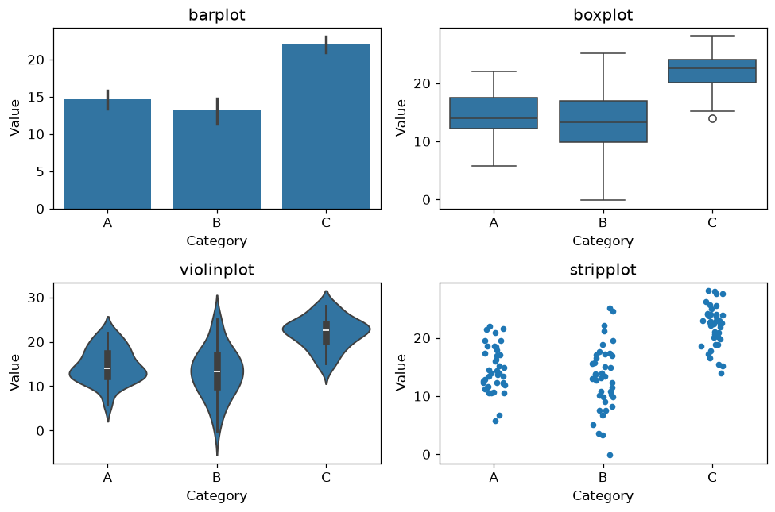
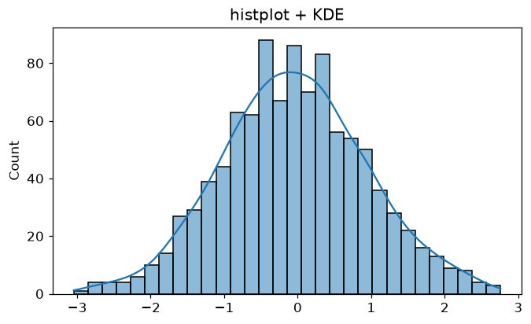
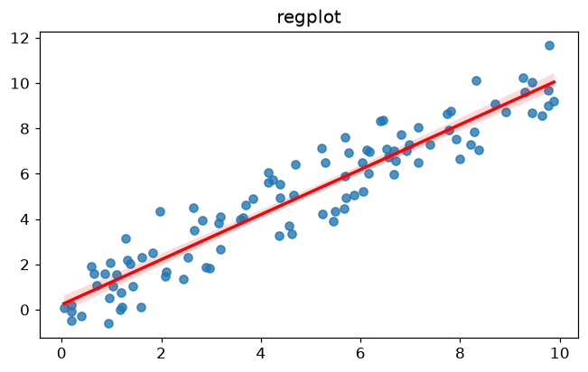
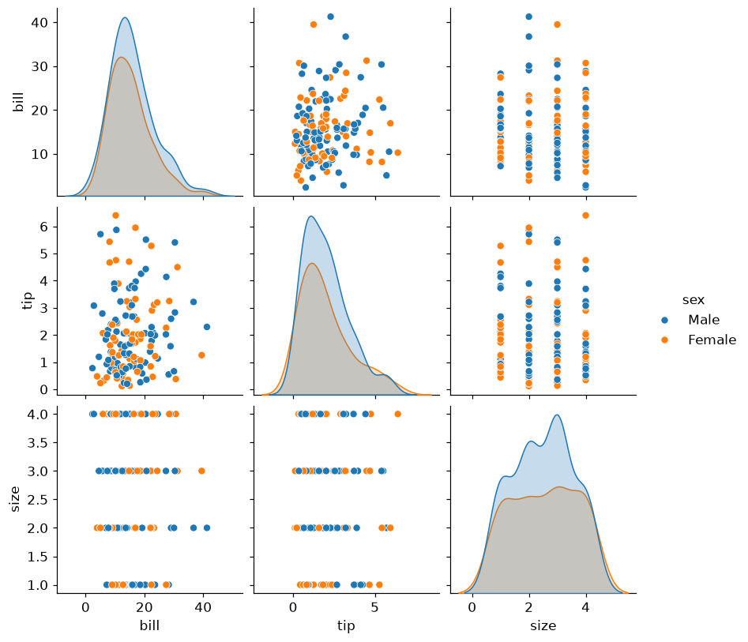

<!-- 📝 글 소개 (출간 시 입력): Seaborn의 통계 시각화 특징과 범주형·연속형·관계형 데이터별 그래프 정리 -->

# 🎈 Seaborn

**Seaborn**은 통계적 데이터 시각화를 쉽게 만들어주는 라이브러리다. **Matplotlib 기반**으로 동작하며, Pandas DataFrame과 직접 연동된다.

```python
import seaborn as sns
sns.scatterplot(x="x", y="y", data=df)   # data=df, x='컬럼명' 형태로 바로 사용
```

> **Matplotlib은 그래프 단위**(막대·히스토그램 등)로 학습하지만, **Seaborn은 데이터 유형 단위**(범주형·연속형·관계형)로 접근한다. 데이터 특성에 맞는 시각화를 자동으로 최적화해주기 때문이다.

Matplotlib보다 짧은 코드로 회귀선·밀도추정(KDE)·신뢰구간 같은 **통계 요소를 내장**해 그려준다.

___

## 📌 범주형 데이터 (Categorical)

정해진 그룹·레이블을 가지는 데이터다. 순서 없는 **명목형**(성별, 혈액형)과 순서 있는 **순서형**(만족도, 등급)으로 나뉜다.

```python
import seaborn as sns
import matplotlib.pyplot as plt
import pandas as pd
import numpy as np

np.random.seed(1)
data = pd.DataFrame({
    "Category": np.repeat(['A', 'B', 'C'], 40),
    "Value": np.concatenate([np.random.normal(15, 4, 40),
                             np.random.normal(12, 6, 40),
                             np.random.normal(22, 5, 40)])
})

fig, ax = plt.subplots(2, 2, figsize=(9, 6))
sns.barplot(x="Category", y="Value", data=data, ax=ax[0, 0])     # 평균 + 신뢰구간
sns.boxplot(x="Category", y="Value", data=data, ax=ax[0, 1])     # 분포 요약
sns.violinplot(x="Category", y="Value", data=data, ax=ax[1, 0])  # 박스 + KDE
sns.stripplot(x="Category", y="Value", data=data, jitter=True, ax=ax[1, 1])  # 개별 점
plt.tight_layout()
plt.show()
```



| 그래프 | 추천 상황 |
| --- | --- |
| **barplot** | 그룹 간 평균 차이 (오차 막대로 신뢰구간 표시) |
| **boxplot** | 중앙값·IQR·이상치 요약 |
| **violinplot** | 분포 모양(비대칭·다봉형)까지 확인 |
| **stripplot** | 표본이 적어 개별 값을 직접 볼 때 |

> **바이올린 플롯은 박스플롯에 KDE(밀도 곡선)를 더한 것**이라, 박스플롯이 못 보여주는 분포의 형태까지 드러난다. `stripplot`의 `jitter=True`는 점이 겹치지 않게 위치를 약간 흩어준다.

___

## 📌 연속형 데이터 (Continuous)

키·온도·연봉처럼 구간 내 무한한 값을 가지는 데이터다. **빈도**로 볼지 **확률 밀도**로 볼지가 핵심이다.

| 구분 | 설명 | 함수 |
| --- | --- | --- |
| 빈도 | 구간별 개수 | `histplot` |
| 확률 밀도(KDE) | 부드러운 분포 곡선 | `kdeplot` |

```python
import numpy as np

np.random.seed(0)
data = np.random.randn(1000)
sns.histplot(data, bins=30, kde=True)     # 히스토그램 + KDE 곡선
plt.show()
```



```python
np.random.seed(0)
x = np.random.rand(100) * 10
y = x + np.random.randn(100)              # x와 상관 있는 y
sns.regplot(x=x, y=y, line_kws={'color': 'red'})   # 산점도 + 회귀선
plt.show()
```



> **KDE(커널 밀도 추정)**는 각 데이터 포인트 주변에 가우시안 커널을 씌워 부드러운 분포 곡선을 만드는 방법이다. 히스토그램이 구간에 따라 울퉁불퉁한 것과 달리 연속적인 분포를 보여준다.

___

## 📌 관계 데이터 (Relational)

두 개 이상 변수의 상관관계·패턴을 분석한다.

```python
import seaborn as sns
import pandas as pd
import numpy as np

np.random.seed(3)
n = 150
df = pd.DataFrame({
    "bill": np.random.gamma(5, 3, n),
    "tip":  np.random.gamma(2, 1, n),
    "size": np.random.randint(1, 5, n).astype(float),
    "sex":  np.where(np.random.rand(n) > 0.5, "Male", "Female"),
})

sns.pairplot(df, hue="sex")   # 모든 수치형 변수 쌍 + 범주별 색상
plt.show()
```



> **페어 플롯(pairplot)**은 데이터셋의 모든 수치형 변수 쌍을 한 Figure에 그린다. 대각선은 각 변수의 분포, 나머지는 변수 쌍의 산점도다. **EDA 초기에 변수 간 상관관계를 한눈에 탐색**할 때 매우 유용하다. `hue`로 범주별 색상을 구분한다.
