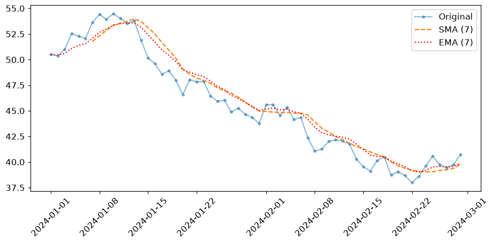
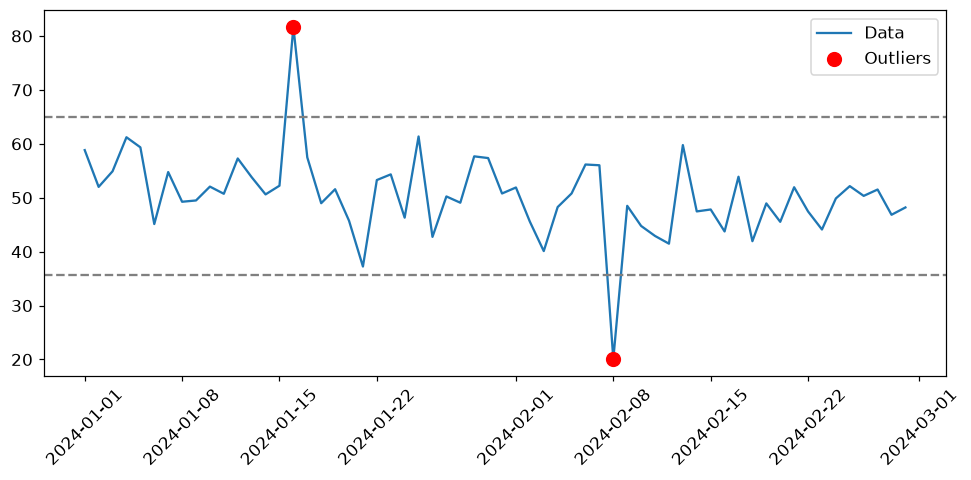
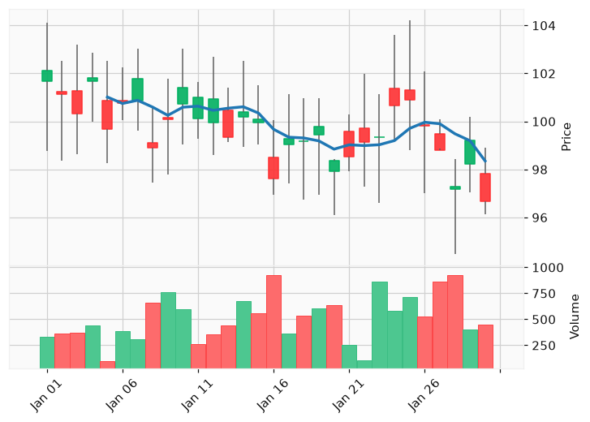

<!-- 📝 글 소개 (출간 시 입력): 시계열 데이터의 이동평균·리샘플링·이상치 탐지와 금융 캔들 차트 정리 -->

# 🎈 시계열 데이터

**시계열 데이터**는 시간의 흐름에 따라 일정 간격으로 측정된 연속적인 데이터다. 주식 가격, 날씨, 웹 트래픽, IoT 센서 값이 대표적이다. **시간을 X축, 관측값을 Y축**으로 두고 분석한다.

시계열을 분석하는 목적은 **추세(Trend)** 파악, **계절성(Seasonality)** 탐지, **이상치**(급등·급락) 감지다.

```python
df = pd.DataFrame({"Date": pd.date_range("2023-01-01", periods=100, freq="D"),
                   "Value": np.cumsum(np.random.randn(100))})  # 누적합으로 시계열 시뮬레이션
sns.lineplot(x="Date", y="Value", data=df)
```

> `np.cumsum()`은 배열의 누적합을 구한다. 이전 값에 다음 값이 더해지는 주가 같은 데이터를 시뮬레이션할 때 쓴다.

___

## 📌 이동평균 (Moving Average)

일정 구간(**Window**)의 평균으로 변동성을 완화해 추세를 본다.

| 유형 | 방식 | 특징 |
| --- | --- | --- |
| **SMA** (단순) | 동일 가중치 평균 | 단순, 최근 변화 반영 느림 |
| **EMA** (지수) | 최근 값에 지수적 가중치 | 변동을 빠르게 반영 |
| **WMA** (가중) | 최근 값에 선형적 가중치 | SMA와 EMA의 중간 |

**반응 속도: EMA > WMA > SMA**

```python
import numpy as np, pandas as pd
import matplotlib.pyplot as plt

np.random.seed(42)
dates = pd.date_range("2024-01-01", periods=60, freq="D")
df = pd.DataFrame({"value": np.cumsum(np.random.randn(60)) + 50}, index=dates)

df["SMA_7"] = df["value"].rolling(window=7).mean()          # 단순 이동평균
df["EMA_7"] = df["value"].ewm(span=7, adjust=False).mean()  # 지수 이동평균

plt.plot(df.index, df["value"], marker="o", ms=3, alpha=0.5, label="Original")
plt.plot(df.index, df["SMA_7"], "--", label="SMA (7)")
plt.plot(df.index, df["EMA_7"], ":", color="red", label="EMA (7)")
plt.legend(); plt.xticks(rotation=45); plt.tight_layout()
plt.show()
```



> `rolling(window=n).mean()`이 SMA, `ewm(span=n).mean()`이 EMA다. **SMA는 앞의 `window-1`개가 NaN**(구간이 안 채워짐)이지만, EMA는 초기값부터 바로 계산된다.

___

## 📌 리샘플링 (Resampling)

시간 간격을 재조정한다. 방향에 따라 처리가 다르다.

| 구분 | 설명 | 처리 |
| --- | --- | --- |
| **다운샘플링** | 긴 간격으로 집계 (일→주) | 평균·합계 등으로 **집계** |
| **업샘플링** | 짧은 간격으로 확장 (일→시간) | 생긴 NaN을 **보간** |

```python
df.resample("D").mean()                    # 다운샘플링 (하루 평균)
df.resample("h").asfreq().interpolate("linear")  # 업샘플링 후 선형 보간
```

주요 간격은 `s`(초) `min`(분) `h`(시) `D`(일) `W`(주) `ME`(월말)다.

> 업샘플링은 없던 시점을 만들어 NaN이 생기므로 **보간(interpolate)**이 필요하다. 선형 보간이 기본이며, 다항식 보간은 데이터가 많아지면 진동(런게 현상)이 생겨 구간별 저차 다항식을 잇는 **스플라인**이 더 안정적이다.

___

## 📌 이상치 탐지 (IQR)

**IQR**(Q3 − Q1) 기준으로 경계를 벗어난 값을 이상치로 본다.

```python
import numpy as np, pandas as pd
import matplotlib.pyplot as plt

np.random.seed(0)
dates = pd.date_range("2024-01-01", periods=60, freq="D")
value = np.random.normal(50, 5, 60)   # 평균 50 주변 노이즈
value[15] += 30                       # 급등 이상치 주입
value[38] -= 28                       # 급락 이상치 주입
df = pd.DataFrame({"value": value}, index=dates)

Q1, Q3 = df["value"].quantile(0.25), df["value"].quantile(0.75)
IQR = Q3 - Q1
lower, upper = Q1 - 1.5*IQR, Q3 + 1.5*IQR
outliers = df[(df["value"] < lower) | (df["value"] > upper)]

plt.plot(df.index, df["value"], label="Data")
plt.scatter(outliers.index, outliers["value"], color="red", s=80, zorder=5, label="Outliers")
plt.axhline(upper, ls="--", color="gray"); plt.axhline(lower, ls="--", color="gray")
plt.legend(); plt.xticks(rotation=45); plt.tight_layout()
plt.show()
```



___

## 📌 금융 데이터와 캔들 차트

주가는 시간 단위로 집계해 **봉(Bar)** 형태로 표현한다. 틱 → 분봉 → 일봉 → 주봉 → 월봉 순으로 묶는다. 집계 시 각 컬럼을 다르게 처리하는 것이 핵심이다.

```python
df.resample("D").agg({
    "Open": "first",   # 시가 = 구간 첫 값
    "High": "max",     # 고가 = 최대
    "Low":  "min",     # 저가 = 최소
    "Close": "last",   # 종가 = 구간 마지막 값
    "Volume": "sum"    # 거래량 = 합계
})
```

> OHLC 집계에서 **시가는 `first`, 종가는 `last`, 고가는 `max`, 저가는 `min`, 거래량은 `sum`**으로 각각 다르게 집계한다. 이 매핑이 금융 리샘플링의 핵심이다.

**캔들 차트**는 시가·고가·저가·종가를 몸통과 꼬리로 표현하며, 상승(양봉)·하락(음봉)을 색으로 구분한다. `mplfinance` 라이브러리로 그린다.

```python
import mplfinance as mpf
import numpy as np, pandas as pd

np.random.seed(7)
dates = pd.date_range("2024-01-01", periods=30, freq="D")
o = np.cumsum(np.random.randn(30)) + 100
h = o + np.random.uniform(0.5, 3, 30)
l = o - np.random.uniform(0.5, 3, 30)
c = (o + h + l) / 3 + np.random.uniform(-1, 1, 30)
v = np.random.randint(100, 1000, 30)
ohlc = pd.DataFrame({"Open": o, "High": h, "Low": l, "Close": c, "Volume": v}, index=dates)

mpf.plot(ohlc, type="candle", style="yahoo", volume=True, mav=(5,))  # mav=(5,): 5일 이동평균선
```



> 변동성(Volatility)처럼 가격과 단위가 다른 지표는 같은 패널에 겹치면 왜곡되므로 **별도 패널(`panel=1`)**에 그린다.
