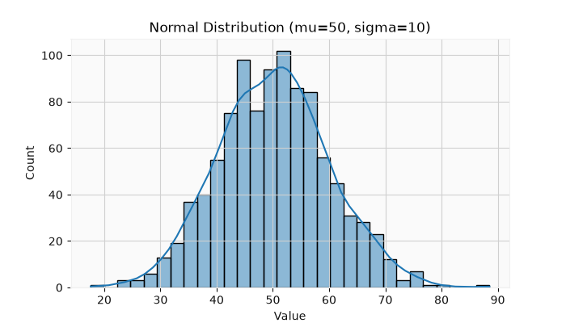
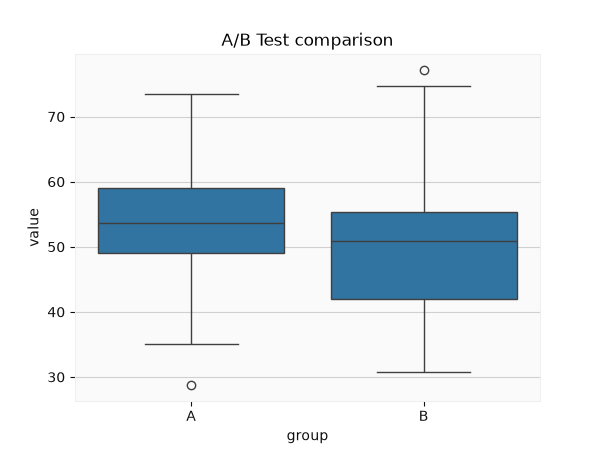

<!-- 📝 글 소개 (출간 시 입력): SciPy 개요와 정규분포, 기술 통계, 가설 검정(t-검정·카이제곱·ANOVA) 정리 -->

# 🎈 SciPy 통계 분석

**SciPy**는 과학 계산과 통계 분석을 위한 파이썬 라이브러리다. **NumPy를 기반**으로 최적화, 보간, 선형대수, 신호 처리, 통계 등 고급 기능을 제공한다.

| 모듈 | 기능 |
| --- | --- |
| `scipy.stats` | 확률 분포, 통계 분석, 가설 검정 |
| `scipy.optimize` | 함수 최적화 |
| `scipy.interpolate` | 데이터 보간 |
| `scipy.fft` | 고속 푸리에 변환 |
| `scipy.integrate` | 수치 적분 |

> NumPy는 배열 연산과 기초 통계(`mean`, `std`)에 집중하지만, **SciPy는 그 위에 확률 분포·가설 검정·최적화 같은 고급 기능**을 얹는다. 통계 분석은 대부분 `scipy.stats`로 한다.

___

## 📌 정규 분포 (Normal Distribution)

평균을 중심으로 좌우 대칭인 종형 곡선을 따르는 확률 분포다. `μ`(평균)가 중심, `σ`(표준편차)가 퍼짐을 결정한다.

- **68-95-99.7 법칙**: μ±1σ 안에 68%, μ±2σ 안에 95%, μ±3σ 안에 99.7%
- t-검정, 회귀분석, PCA 등 많은 통계 기법이 정규 분포를 가정한다

```python
import scipy.stats as stats

stats.norm.pdf(55, loc=50, scale=10)   # PDF — 특정 값의 확률 밀도
stats.norm.cdf(55, loc=50, scale=10)   # CDF — 55 이하일 누적 확률 (0.69)
stats.norm.ppf(0.90, loc=50, scale=10) # PPF — 상위 10% 경계값 (62.8)
```

정규 분포를 따르는 데이터의 분포는 히스토그램 + KDE로 확인한다.

```python
import numpy as np
import seaborn as sns
import matplotlib.pyplot as plt

np.random.seed(42)
data = np.random.normal(50, 10, 1000)   # 평균 50, 표준편차 10
sns.histplot(data, bins=30, kde=True)
plt.title("Normal Distribution (mu=50, sigma=10)")
plt.xlabel("Value")
plt.show()
```



> **PDF의 y값은 확률(%)이 아니다.** 확률은 곡선 아래 **면적**이고, y값은 그 지점의 밀도(데이터 밀집 정도)다. 특정 값 이하일 확률은 CDF, 반대로 특정 확률의 경계값은 PPF로 구한다.

**Z-점수**로 표준화하면 서로 다른 분포를 비교할 수 있다. `Z = (X − μ) / σ`로 평균 0, 표준편차 1인 표준 정규 분포로 바꾼다.

___

## 📌 기술 통계 (Descriptive Statistics)

데이터를 요약하는 지표들이다. 세 범주로 나뉜다.

| 범주 | 지표 |
| --- | --- |
| **중앙 경향성** | 평균(이상값에 민감), 중앙값(이상값에 강함), 최빈값 |
| **산포도** | 범위, 분산, 표준편차, IQR |
| **분포 형태** | 왜도(치우침), 첨도(뾰족함) |

```python
df.describe()                          # count·mean·std·min·25%·50%·75%·max 한 번에
np.std(df["value"], ddof=1)            # 표준편차 (표본)
stats.skew(df["value"])                # 왜도
stats.kurtosis(df["value"])            # 첨도
```

> **`ddof=1`**은 표본으로 모집단 분산을 추정할 때 `n` 대신 `n-1`로 나눠 과소평가를 보정한다(불편분산). `ddof=0`(기본)은 모분산이다. 표본 데이터를 다룰 때는 보통 `ddof=1`을 쓴다.
>
> **왜도**는 0보다 크면 오른쪽 꼬리(양의 왜도), **첨도**는 3보다 크면 뾰족한 분포다.

___

## 📌 가설 검정 (Hypothesis Testing)

**시각적으로 보이는 차이가 우연인지, 통계적으로 유의미한지** 판단하는 과정이다.

| 개념 | 설명 |
| --- | --- |
| **귀무가설(H₀)** | "차이가 없다" — 반증 대상 |
| **대립가설(H₁)** | "차이가 있다" — 증명하려는 가설 |
| **p값** | H₀가 참일 때 현재만큼 극단적 결과가 나올 확률 |
| **유의수준(α)** | 기각 기준, 보통 0.05 |

핵심은 **p값과 α 비교**다.

```python
import numpy as np, pandas as pd
import scipy.stats as stats
import seaborn as sns
import matplotlib.pyplot as plt

np.random.seed(42)
group_A = np.random.normal(55, 10, 100)
group_B = np.random.normal(50, 10, 100)

t_stat, p_value = stats.ttest_ind(group_A, group_B, equal_var=False)
# p-value: 0.0050 → p < 0.05 이므로 H₀ 기각 (차이 유의미)

df = pd.DataFrame({"value": np.concatenate([group_A, group_B]),
                   "group": ["A"] * 100 + ["B"] * 100})
sns.boxplot(x="group", y="value", data=df)
plt.title("A/B Test comparison")
plt.show()
```



> **`p < 0.05`이면 귀무가설을 기각**해 "차이가 유의미하다"고 결론짓고, `p ≥ 0.05`이면 H₀를 유지한다. H₀가 참인데 기각하면 **1종 오류**(효과 없는데 있다고 착각), H₁이 참인데 기각 못 하면 **2종 오류**다.

데이터와 목적에 따라 검정 방법을 고른다.

| 검정 | 문법 | 용도 |
| --- | --- | --- |
| 단일 표본 t-검정 | `ttest_1samp` | 한 그룹 평균이 특정 값과 다른지 |
| 독립 표본 t-검정 | `ttest_ind` | 두 그룹 평균 차이 |
| 대응 표본 t-검정 | `ttest_rel` | 같은 그룹의 전/후 비교 |
| 카이제곱 검정 | `chi2_contingency` | 범주형 변수 간 독립성 |
| ANOVA | `f_oneway` | 3개 이상 그룹 평균 비교 |

___

## 📌 통계적 시각화

분석하는 변수 개수에 따라 시각화가 달라진다.

| 구분 | 분석 대상 | 대표 시각화 |
| --- | --- | --- |
| **단변량** | 변수 1개의 분포 | 히스토그램, KDE, 박스플롯 |
| **이변량** | 변수 2개의 관계 | 산점도, 회귀선, 상관 행렬 |
| **다변량** | 변수 3개 이상 | 페어플롯, 히트맵 |

> 가설 검정 결과를 박스플롯·막대그래프로 함께 시각화하면 통계적 차이를 직관적으로 확인할 수 있다. 예를 들어 A/B 테스트의 t-검정 결과를 두 그룹 박스플롯으로 나란히 보여주는 식이다.
