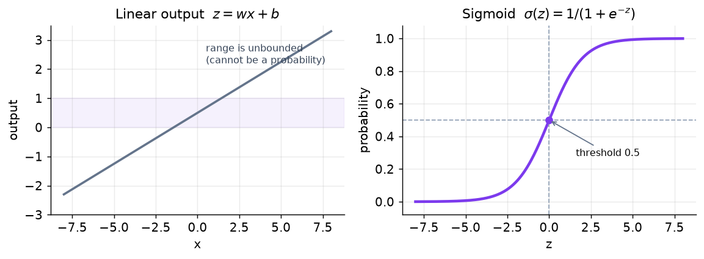
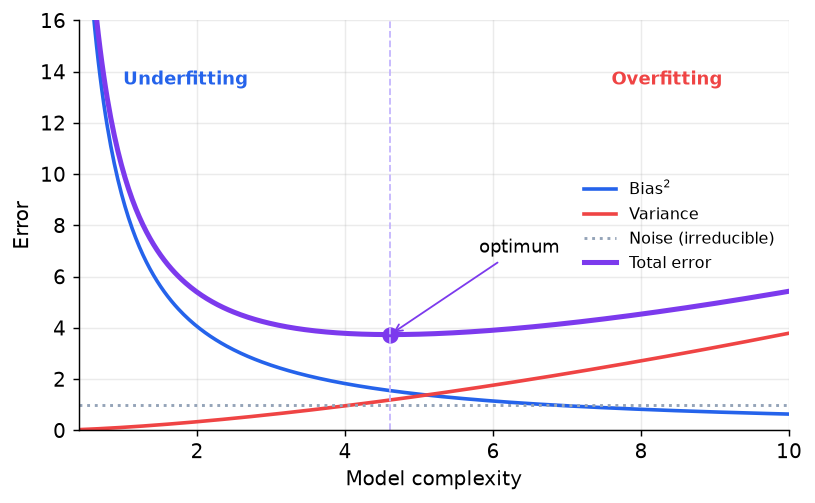
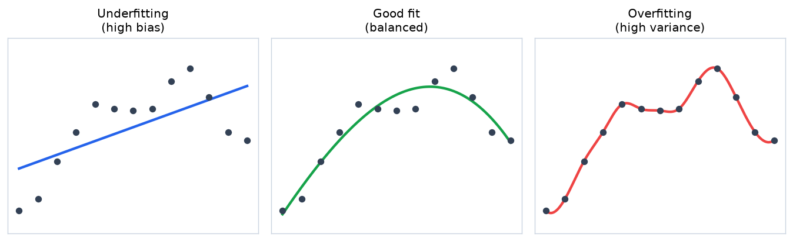

<!-- 📝 글 소개 (출간 시 입력): 머신러닝의 학습 방식 분류와 회귀·분류, 편향-분산 트레이드오프 정리 -->

# 🎈 머신러닝 기본기

___

## 📌 Machine Learning

데이터 속의 패턴을 스스로 학습해 예측·분류하는 알고리즘 분야

- 모델이 학습하는 것은 **결정 경계(Decision Boundary)** 또는 입력과 출력을 잇는 함수
- 규칙을 사람이 작성하지 않고 **데이터에서 도출**

**규칙 기반 시스템과의 차이**

| 구분 | 규칙 기반 | 머신러닝 |
| --- | --- | --- |
| 규칙 생성 | 사람이 `if ~ then` 직접 작성 | 데이터에서 자동 학습 |
| 변화 대응 | 규칙을 일일이 수정 | 데이터 추가 후 재학습 |
| 적합한 문제 | 규칙이 명확하고 적을 때 | 예외가 많고 패턴이 복잡할 때 |

___

## 📌 AI · ML · DL

**AI ⊃ ML ⊃ DL**의 포함 관계

- **AI** — 머신러닝 외에 규칙 기반 시스템, 탐색·최적화, 지식 추론, 진화 알고리즘도 포함
- **ML** — 그중 데이터로 학습하는 갈래
- **DL** — ML 중 심층 신경망을 쓰는 갈래

**머신러닝 vs 딥러닝**

| 구분 | 머신러닝 | 딥러닝 |
| --- | --- | --- |
| 특징 추출 | **사람이 설계** (Feature Engineering) | **모델이 자동 학습** |
| 데이터 규모 | 적은 데이터로도 동작 | 대량 데이터 필요 |
| 연산 자원 | CPU로 충분한 경우가 많음 | GPU 사실상 필수 |
| 해석 가능성 | 높음 (특성 중요도 등) | 낮음 (블랙박스) |

**핵심 차이** — 특징(feature)을 누가 만드는가

- 머신러닝: 고양이 분류에 "귀의 각도", "털의 질감"을 사람이 정의
- 딥러닝: 픽셀을 그대로 입력 → 앞쪽 층이 선·모서리, 뒤쪽 층이 눈·귀 형태를 학습

**딥러닝이 항상 유리하지는 않음**

- **정형 데이터**(테이블) — 부스팅 계열이 더 좋은 경우가 많음
- **비정형 데이터**(이미지·음성·텍스트) — 사람이 특징을 정의하기 어려워 딥러닝이 압도

___

## 📌 학습 방식

| 방식 | 데이터 | 목표 | 예시 |
| --- | --- | --- | --- |
| **지도 학습** | 입력 + 정답 라벨 | 입력 → 정답 매핑 | 분류, 회귀 |
| **비지도 학습** | 입력만 | 데이터 구조·패턴 발견 | 군집화, 차원 축소 |
| **자기지도 학습** | 입력만 | 라벨을 데이터에서 생성해 표현 학습 | BERT 마스킹, GPT 다음 토큰 예측 |
| **강화 학습** | 환경 상호작용 + 보상 | 누적 보상 최대화 | 게임 AI, RLHF |

**자기지도 학습이 중요한 이유**

- 사람이 라벨을 붙이지 않아도 학습 가능 → **인터넷 규모의 텍스트를 학습에 투입**
- **LLM 사전학습의 토대**

___

## 📌 회귀 vs 분류

지도 학습을 **출력이 연속형인가 범주형인가**로 나눈 구분

| 구분 | 회귀 (Regression) | 분류 (Classification) |
| --- | --- | --- |
| 출력 | 연속적인 수치 | 이산적인 범주 |
| 질문 | "얼마인가?" | "어느 그룹인가?" |
| 예시 | 집 크기 → 집값 | 이메일 → 스팸 여부 |
| 손실 함수 | **MSE, MAE** | **Cross Entropy** |
| 평가 지표 | MSE, RMSE, R² | 정확도, 정밀도, 재현율, F1 |

___

## 📌 Linear Regression

x와 y의 관계를 $y = wx + b$ 직선으로 모델링하는 회귀 모델

**학습 방식**

- **최소 제곱법(OLS)** — 잔차(실제값 − 예측값)를 제곱해 더한 값이 최소가 되는 $w$, $b$를 탐색

**잔차를 제곱하는 이유**

- 부호가 다른 오차끼리 상쇄되는 것을 방지
- 큰 오차에 더 큰 페널티 부여
- 단점: **이상치에 민감** → 이상치가 많으면 MAE, Huber Loss 고려

**가정** — 선형성, 오차의 독립성·등분산성

___

## 📌 Logistic Regression

선형 출력을 확률로 변환해 분류에 사용하는 모델 (이름은 회귀지만 **분류 모델**)

**동작 원리**

- 선형 출력 $wx + b$는 범위 제한이 없어 확률로 사용 불가
- **시그모이드 함수**로 0~1 범위로 변환 → 확률로 해석
- 확률이 임계값(보통 0.5)을 넘으면 해당 클래스로 분류

$$\sigma(z) = \frac{1}{1 + e^{-z}}$$



**손실 함수로 Cross Entropy를 쓰는 이유**

- 분류에서 MSE를 쓰면 **크게 틀렸을 때 기울기가 작아져** 학습이 느려짐
- Cross Entropy는 틀릴수록 기울기가 커짐

___

## 📌 Bias-Variance Tradeoff

모델의 예측 오차를 편향·분산·노이즈로 분해해 보는 관점

$$오차 = 편향^2 + 분산 + 노이즈$$

| 구성 | 의미 | 원인 |
| --- | --- | --- |
| **편향 (Bias)** | 예측이 정답에서 체계적으로 벗어난 정도 | 모델이 너무 단순함 |
| **분산 (Variance)** | 훈련 데이터가 바뀔 때 예측이 흔들리는 정도 | 모델이 너무 복잡함 |
| **노이즈** | 데이터 자체의 무작위성 | 어떤 모델로도 줄일 수 없음 |



**핵심** — 편향과 분산은 **동시에 줄일 수 없음**. 모델이 복잡해지면 편향은 줄고 분산은 커짐

___

## 📌 Overfitting vs Underfitting

| 구분 | 과적합 (Overfitting) | 과소적합 (Underfitting) |
| --- | --- | --- |
| 상태 | 훈련 데이터에 과도하게 맞춰짐 | 데이터 패턴조차 학습 못 함 |
| Training error | 낮음 | 높음 |
| Test error | 높음 | 높음 |
| 편향 / 분산 | 낮음 / **높음** | **높음** / 낮음 |
| 모델 복잡도 | 너무 복잡 | 너무 단순 |
| 예시 | 너무 깊은 Decision Tree | 복잡한 데이터를 Linear Regression으로 학습 |



**과적합의 원인**

- 모델이 너무 복잡함
- 데이터가 부족함
- Feature 수가 너무 많음 (**차원의 저주**)
- 데이터에 노이즈가 많음

**진단 방법** — 훈련 성능과 검증 성능의 차이

- **둘 다 나쁨** → 과소적합. 모델을 키우거나 특징을 추가
- **훈련만 좋음** → 과적합. 데이터를 늘리거나 정규화를 적용

**과적합 대응**

- 데이터 추가, 데이터 증강
- **정규화(L1 / L2)**
- Feature Selection
- **Cross Validation**
- **Early Stopping**, Dropout

___

## 📌 머신러닝 동작 흐름

```
데이터 수집 → 전처리 → 데이터 분할 → 모델 선택·훈련 → 평가
   → (성능 미달) 모델 조정 후 재훈련 ↩
   → (성능 만족) 배포 → 모니터링
```

- **한 번에 끝나지 않는 순환 구조**
- 배포 이후에도 입력 데이터 분포가 변하면(**데이터 드리프트**) 재학습 필요

___

## 📌 정리

- 머신러닝은 규칙을 사람이 작성하는 대신 **데이터에서 결정 경계·함수를 학습**한다
- 머신러닝과 딥러닝의 차이는 **특징을 사람이 설계하는가, 모델이 학습하는가**이며 정형 데이터에서는 딥러닝이 항상 유리하지 않다
- **자기지도 학습**은 라벨을 데이터 자체에서 만들어내며 LLM 사전학습의 토대이다
- 회귀와 분류는 출력 형태로 나뉘고 이에 따라 **손실 함수와 평가 지표**가 달라진다
- **로지스틱 회귀**는 선형 출력을 시그모이드로 확률화한 분류 모델이며, 손실 함수는 Cross Entropy이다
- 예측 오차는 **편향·분산·노이즈**로 분해되며 편향과 분산은 동시에 줄일 수 없다
- **과적합은 낮은 편향·높은 분산**, 과소적합은 높은 편향·낮은 분산 상태이다
- 훈련·검증 성능을 비교해 **둘 다 나쁘면 과소적합, 훈련만 좋으면 과적합**으로 진단한다
