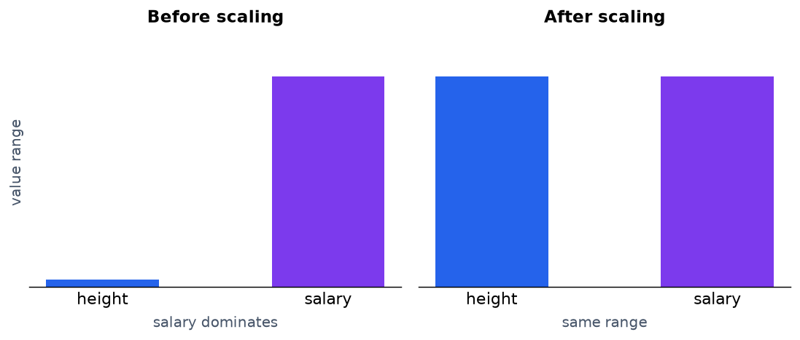
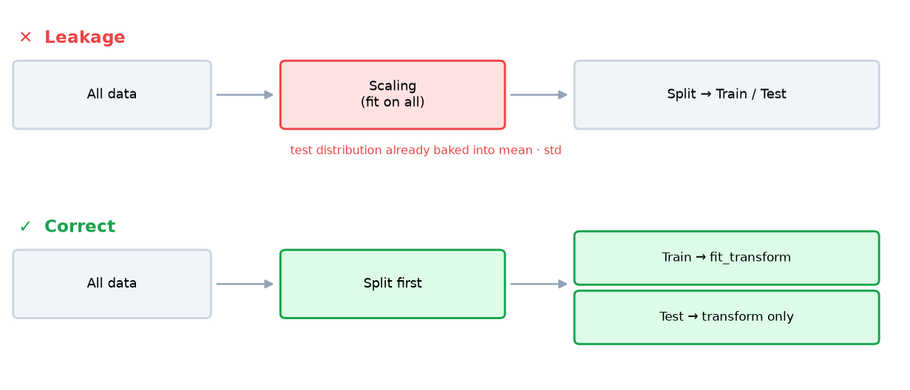
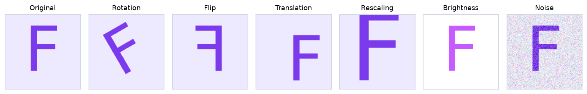

<!-- 📝 글 소개 (출간 시 입력): 스케일링·인코딩·데이터 분할·데이터 누수·증강 등 모델 학습 전 데이터 처리 과정 정리 -->

# 🎈 데이터 전처리

___

## 📌 Data Preprocessing

원본 데이터를 모델이 학습할 수 있는 형태로 정제·변환하는 과정

- 모델 구조를 바꾸는 것보다 **데이터 품질 개선이 성능 향상 폭이 큰 경우가 많음**

| 작업 | 목적 |
| --- | --- |
| 결측값 처리 | 누락된 값을 제거하거나 대체 |
| 이상치 처리 | 입력·계측 오류로 생긴 비정상 값 처리 |
| 스케일링 | 특성 간 값의 범위를 통일 |
| 인코딩 | 문자열 범주를 수치형으로 변환 |
| 데이터 분할 | 학습·검증·테스트 셋 분리 |

___

## 📌 결측값 처리

| 방법 | 특징 |
| --- | --- |
| 행 제거 | 간단하지만 데이터가 적으면 손실이 큼 |
| 평균 대체 | 극단값 하나에도 크게 흔들림 |
| **중앙값 대체** | 순서상 가운데 값이라 **이상치 영향이 거의 없음** |

**주의**

- 결측이 무작위가 아니면(특정 그룹만 응답 누락) 대체 시 **편향 발생**
- 대체값은 **훈련 셋 기준으로 계산** → 전체 데이터로 계산하면 데이터 누수

___

## 📌 이상치 처리

- 판단 기준: 도메인 지식(연봉이 음수) 또는 통계 기준
- **무조건 제거가 정답은 아님** — 사기 탐지, 설비 고장 예측에서는 **이상치 자체가 찾아야 할 대상**
- 노이즈인지 신호인지 판단이 먼저

___

## 📌 Standardization vs Normalization

특성 간 값의 범위를 통일하는 작업

| 방식 | 수식 | 결과 범위 | 특징 |
| --- | --- | --- | --- |
| **표준화 (Standardization)** | $\frac{x - \mu}{\sigma}$ | 제한 없음 | 평균 0, 표준편차 1. **이상치에 상대적으로 강함** |
| **정규화 (Normalization)** | $\frac{x - min}{max - min}$ | 0 ~ 1 | 범위 고정. **이상치 하나에 전체가 압축됨** |



**필요한 이유**

- 단위가 다르면 값의 범위가 큰 특성이 결과를 지배
- 키(170cm)와 연봉(50,000,000)을 함께 쓰면 **거리 계산에 연봉 차이만 반영**

**선택 기준**

- 분포를 모르거나 이상치가 있음 → **표준화**
- 범위가 0~255처럼 이미 정해짐(이미지 픽셀) → **정규화**

**스케일링이 필요한 모델**

| 필요 | 불필요 |
| --- | --- |
| K-NN, SVM, 선형 회귀, 신경망 | 트리 계열 (Decision Tree, Random Forest) |
| 거리·가중치 크기에 의존 | 특성을 개별 기준으로 분할, 특성 간 값을 비교하지 않음 |

___

## 📌 Label Encoding vs One-Hot Encoding

문자열 범주를 모델이 처리할 수 있는 수치형으로 변환하는 작업

| 방식 | 변환 | 문제 |
| --- | --- | --- |
| **레이블 인코딩** | 사과=0, 바나나=1, 딸기=2 | 모델이 **크기·순서가 있다고 오해** |
| **원-핫 인코딩** | 사과=[1,0,0], 바나나=[0,1,0] | 범주가 많으면 **열이 폭증** |

**선택 기준**

- **명목형**(색상, 도시, 혈액형) — 순서가 없음 → 원-핫 인코딩
- **순서형**(등급 A>B>C, 만족도) — 순서 자체가 정보 → 레이블 인코딩

**모델별 차이**

- 트리 계열 — 레이블 인코딩 값도 분기 조건으로 나누므로 순서 오해 문제가 덜함
- 선형 모델·거리 기반 모델 — 순서 해석이 **치명적**

___

## 📌 Train / Validation / Test Split

| 데이터 | 역할 |
| --- | --- |
| **학습 (Train)** | 모델이 가중치를 학습 |
| **검증 (Validation)** | 하이퍼파라미터 선택, 학습 중 성능 모니터링 |
| **테스트 (Test)** | 최종 성능 측정 — 학습 과정에서 한 번도 사용하지 않음 |

**검증 셋이 따로 필요한 이유**

- 테스트 셋을 보며 하이퍼파라미터를 고르면 **사람이 테스트 셋에 맞춰 튜닝**하는 셈
- 결과적으로 **테스트 셋에 간접적으로 과적합** → 측정된 성능이 실제보다 낙관적
- 검증 셋이 이 튜닝 과정을 대신 받아냄

**주요 옵션**

| 옵션 | 역할 |
| --- | --- |
| `random_state` | 시드 고정. 없으면 실행마다 분할이 달라져 **모델 간 성능 비교 불가** |
| `stratify` | 분할 후에도 **클래스 비율 유지**. 불균형 데이터에서 소수 클래스 누락 방지 |

**분할 비율**

- 8:2, 7:3은 규칙이 아니라 관행
- 수백만 건 → 테스트에 1%만 써도 충분
- 수백 건 → 분할 대신 **교차 검증(Cross Validation)**
- 시계열 → 무작위 분할이 아니라 **시간 순서로 분할**

___

## 📌 Data Leakage

테스트 데이터의 정보가 학습 과정에 새어 들어가는 현상

- 검증 성능은 좋은데 **실제 서비스에서 성능이 무너지는 대표적 원인**



**대표적인 발생 경로**

- **분할 전에 스케일링** — 전체 데이터로 `fit`하면 평균·표준편차에 테스트 분포 정보가 포함됨
- 결측값 대체값을 전체 데이터로 계산
- 시계열에서 미래 데이터로 과거를 예측
- 타깃과 직접 연결된 파생 변수 사용

**방지 방법**

```python
scaler.fit_transform(X_train)   # 훈련 셋에서만 통계량 학습
scaler.transform(X_test)        # 같은 기준을 적용만 (fit 금지)
```

- `fit`은 **훈련 셋에만**, 테스트 셋에는 `transform`만
- **`Pipeline` 사용** — 교차 검증 시 각 폴드의 훈련 부분으로만 `fit`되어 누수를 구조적으로 차단

___

## 📌 Data Augmentation

기존 데이터를 변형해 새로운 학습 데이터를 만드는 기법

**과적합을 막는 원리**

- 모델이 **매 에폭 조금씩 다른 입력**을 보게 됨
- 특정 이미지를 통째로 외우기 어려워짐 → 위치·각도 변화에 강해짐

| 기법 | 내용 |
| --- | --- |
| 회전 (Rotation) | 일정 각도 회전 |
| 반전 (Flipping) | 좌우·상하 반전 |
| 이동 (Translation) | x, y 방향 픽셀 이동 |
| 크기 조절 (Rescaling) | 확대·축소 |
| 색상 변형 (Color Jittering) | 밝기·대비·채도 조절 |
| 노이즈 추가 | 무작위 픽셀 변화 |



- 텍스트 — 다른 언어로 번역했다 되돌리는 **역번역(Back-Translation)**
- 음성 — 재생 속도 변경

**주의할 점**

- **라벨이 바뀌는 변형 금지** — 숫자 6을 180도 회전하면 9, 좌우 반전한 글자는 다른 글자
- **훈련 데이터에만 적용** — 검증·테스트까지 변형하면 실제와 다른 조건에서 성능 측정
- 정형 데이터는 효과 제한적 — 숫자 하나만 바뀌어도 의미가 달라짐

___

## 📌 정리

- 결측값은 **중앙값 대체**가 무난하고, 대체값은 훈련 셋 기준으로 계산해야 한다
- 이상치는 무조건 제거 대상이 아니라 **탐지 대상 자체**일 수도 있다
- **표준화**는 평균 0·표준편차 1로 이상치에 강하고, **정규화**는 0~1 범위지만 이상치 하나에 분포가 압축된다
- 스케일링은 **거리·가중치 기반 모델(K-NN, SVM, 신경망)에 필요**하고 트리 계열에는 필요 없다
- 순서 없는 범주는 **원-핫**, 순서 있는 범주는 레이블 인코딩을 쓴다
- **검증 셋이 필요한 이유**는 테스트 셋으로 튜닝하면 테스트 셋에 과적합되어 성능이 낙관적으로 측정되기 때문이다
- **데이터 누수**를 막으려면 스케일러를 훈련 셋에만 `fit`하고, 교차 검증에는 `Pipeline`을 사용한다
- 증강은 **훈련 데이터에만** 적용하고, 라벨이 바뀌는 변형(6↔9)은 쓰지 않는다
