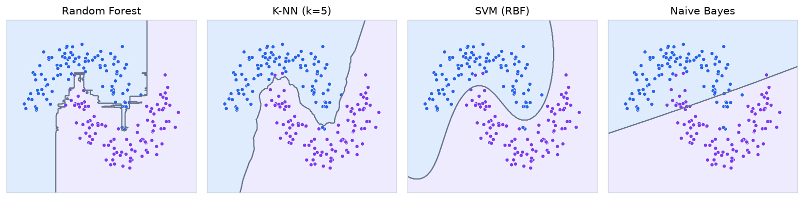
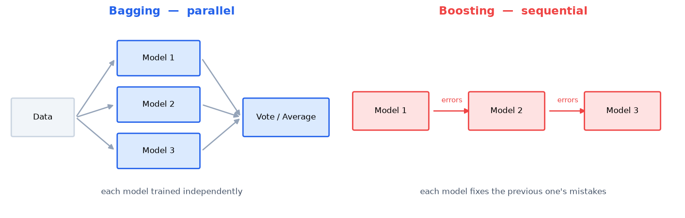
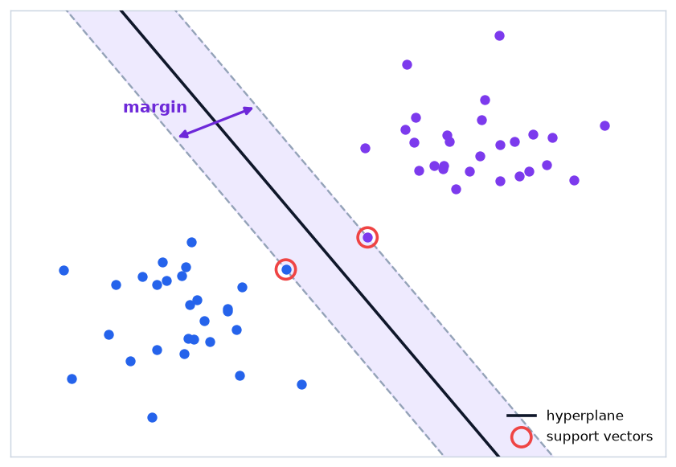

<!-- 📝 글 소개 (출간 시 입력): 의사결정 트리·앙상블·K-NN·SVM·나이브 베이즈의 원리 비교와 K-Means·PCA 정리 -->

# 🎈 지도학습 알고리즘

사이킷런은 알고리즘이 달라도 `fit()` → `predict()`로 사용법이 같다. 중요한 것은 **각 알고리즘이 무엇을 기준으로 결정 경계를 만드는가**이다.



- **트리 계열** — 축에 평행한 계단 모양
- **K-NN** — 이웃에 따라 울퉁불퉁한 지역 경계
- **SVM (RBF)** — 부드러운 곡선
- **Naive Bayes** — 확률 분포에 따른 완만한 경계

___

## 📌 Decision Tree

특성값을 기준으로 조건 분기하며 데이터를 나누는 트리 구조 모델

```
            [비가 오는가?]
            /          \
          예            아니오
         /                 \
 [바람이 강한가?]        [우산 불필요]
```

| 구성 | 역할 |
| --- | --- |
| 루트 노드 | 전체 데이터를 담은 시작점 |
| 내부 노드 | 특성 기준으로 데이터를 분할 |
| 리프 노드 | 최종 예측값 |

**분할 기준 — 불순도(Impurity)**

한 노드에 여러 클래스가 섞인 정도. **불순도가 가장 많이 줄어드는 방향**으로 분할

| 기준 | 수식 | 특징 |
| --- | --- | --- |
| **지니 불순도** | $1 - \sum p_i^2$ | 계산이 빠름. 사이킷런 기본값 |
| **엔트로피** | $-\sum p_i \log_2 p_i$ | 정보 이론 기반. 로그 연산으로 느림 |

- 한 클래스만 있으면 불순도 0, 클래스가 반반이면 최대
- **정보 이득(Information Gain)** = 분할 전 불순도 − 분할 후 불순도의 가중 평균
- 두 기준의 결과 차이는 실제로 크지 않음

**한계와 대응**

- 깊게 자라면 훈련 데이터를 통째로 외워 **과적합**
- `max_depth`, `min_samples_leaf`로 성장 제한 또는 **가지치기(pruning)**

___

## 📌 Ensemble

여러 모델의 예측을 결합해 단일 모델보다 나은 성능을 얻는 기법

| 기법 | 학습 방식 | 줄이는 것 | 대표 모델 |
| --- | --- | --- | --- |
| **배깅 (Bagging)** | 독립적·병렬 학습 후 다수결·평균 | **분산** | Random Forest |
| **부스팅 (Boosting)** | 이전 모델의 오차를 보완하며 순차 학습 | **편향** | XGBoost, LightGBM |
| **스태킹 (Stacking)** | 여러 모델의 예측을 메타 모델의 입력으로 사용 | — | 조합에 따라 다양 |



**배깅 vs 부스팅**

| 구분 | 배깅 | 부스팅 |
| --- | --- | --- |
| 학습 순서 | 병렬 (독립) | 순차 (의존) |
| 각 모델 | 깊은 트리 | 얕은 트리 (weak learner) |
| 과적합 | 상대적으로 강함 | 반복이 많으면 위험 |
| 성능 | 안정적 | 튜닝하면 더 높음 |

___

## 📌 Random Forest

여러 의사결정 트리를 배깅으로 결합한 앙상블 모델

**두 가지 무작위성**

- **부트스트랩 샘플링** — 각 트리를 중복 허용 무작위 샘플로 학습
- **무작위 특성 선택** — 각 분할 지점에서 전체 특성 중 일부만 후보로 사용

**무작위성을 넣는 이유**

- 둘 다 **트리 간 상관관계를 낮추기 위한 장치**
- 트리들이 서로 비슷하면 결합해도 오차가 그대로 남음

**장점**

- 단일 트리의 과적합 완화
- **특성 중요도(Feature Importance)** 제공
- 트리를 독립적으로 학습하므로 **병렬 처리 가능**

___

## 📌 Boosting

이전 모델이 틀린 샘플에 가중치를 주며 순차적으로 학습하는 앙상블 기법

- 약한 모델(weak learner)을 계속 더해 **편향을 줄이는** 방식
- 대표 모델: **XGBoost, LightGBM, CatBoost**

**특징**

- **정형 데이터에서 딥러닝보다 좋은 성능을 내는 경우가 많음** — 캐글 정형 데이터 대회 상위권 대부분이 이 계열
- 반복 횟수가 많으면 과적합 위험 → 학습률·트리 수 튜닝 필요

___

## 📌 K-NN (K-Nearest Neighbors)

새로운 데이터와 가장 가까운 K개 이웃의 라벨로 결과를 정하는 알고리즘

**동작 방식**

- 학습 단계에서 파라미터를 추정하지 않고 **데이터를 저장만 함** → **게으른 학습(Lazy Learning)**
- 연산이 전부 예측 시점에 발생 → 데이터가 커질수록 **예측이 느려짐**

**K 값의 영향**

| K 값 | 결과 |
| --- | --- |
| 작음 | 노이즈 하나에 예측이 흔들림 → **과적합** |
| 큼 | 국소적 패턴을 놓침 → **과소적합** |

- 거리 척도: **유클리디안 거리** $\sqrt{\sum(x_i - y_i)^2}$, 맨해튼 거리
- 이진 분류에서는 동점을 피하려고 **K를 홀수**로 지정
- **스케일링 필수** — 단위가 큰 특성이 거리를 지배

___

## 📌 SVM (Support Vector Machine)

두 클래스를 나누는 경계 중 **마진이 가장 큰 초평면**을 찾는 알고리즘



| 용어 | 의미 |
| --- | --- |
| **초평면(Hyperplane)** | 클래스를 구분하는 경계 (2차원이면 직선) |
| **마진(Margin)** | 초평면과 가장 가까운 데이터 사이의 거리 |
| **서포트 벡터** | 마진 위에 놓여 경계를 결정하는 소수의 샘플 |

**마진을 최대화하는 이유**

- 경계가 데이터에 바짝 붙으면 새 데이터가 조금만 달라도 반대편으로 넘어감
- 여유를 둘수록 **일반화 성능 향상**

**이상치에 강한 이유**

- 경계가 **서포트 벡터만으로 정의**됨
- 경계에서 먼 데이터는 결과에 영향을 주지 않음

**커널 트릭 (Kernel Trick)**

선형으로 나뉘지 않는 데이터를 처리하는 방법. 고차원으로 실제 변환하지 않고 **고차원에서의 내적만 계산**해 비선형 경계 생성

| 커널 | 특징 |
| --- | --- |
| **Linear** | 계산량이 적고 선형 분리 가능한 데이터에 적합 |
| **RBF (Gaussian)** | 가장 유연한 비선형 경계. 사이킷런 기본값 |
| **Polynomial** | 다항식 곡선 경계. 차수가 높으면 계산량 급증 |

- **스케일링 필수** — 마진을 거리로 계산

___

## 📌 Naive Bayes

베이즈 정리로 각 클래스에 속할 확률을 계산해 가장 높은 클래스를 고르는 분류 모델

$$P(A|B) = \frac{P(B|A) \times P(A)}{P(B)}$$

**"Naive(순진한)"의 의미**

- **모든 특성이 서로 독립**이라고 가정
- 현실에서 이 가정은 대부분 성립하지 않음

**그럼에도 잘 동작하는 이유**

- 독립 가정 덕분에 결합 확률이 개별 확률의 곱으로 단순화 → **계산이 매우 빠름**
- 가정이 어긋나도 **클래스 간 확률의 순서는 대체로 유지**됨
- 분류는 확률의 절대값이 아니라 **크기 비교**로 결정되므로 성능에 큰 지장 없음

**활용**

- 특성이 많고 희소한 **텍스트 분류·스팸 필터링**에 강함
- 연속형 데이터 → 각 특성이 정규분포를 따른다고 보는 **GaussianNB**

___

## 📌 알고리즘 비교

| 알고리즘 | 원리 | 강점 | 약점 | 스케일링 |
| --- | --- | --- | --- | --- |
| **Decision Tree** | 불순도 감소 분할 | 해석이 쉬움 | 단독으로는 과적합 | 불필요 |
| **Random Forest** | 트리 배깅 | 과적합에 강함, 특성 중요도 | 모델이 크고 예측이 느림 | 불필요 |
| **Boosting** | 오차 보완 순차 학습 | 정형 데이터 최고 성능 | 튜닝 민감, 과적합 위험 | 불필요 |
| **K-NN** | K개 이웃 다수결 | 단순, 비선형 경계 | 예측 시 전체 거리 계산 | **필수** |
| **SVM** | 마진 최대화 | 고차원·소규모에 강함 | 대용량 학습 느림 | **필수** |
| **Naive Bayes** | 독립 가정 + 확률 | 매우 빠름, 텍스트에 강함 | 독립 가정이 깨지면 확률 왜곡 | 불필요 |

___

## 📌 K-Means

데이터를 K개 군집으로 나누는 비지도 학습 알고리즘

**동작 순서**

1. 중심점 K개를 무작위로 배치
2. 각 데이터를 가장 가까운 중심점에 할당
3. 각 군집의 평균으로 중심점 이동
4. 중심점이 변하지 않을 때까지 2~3 반복

| 항목 | 내용 |
| --- | --- |
| K 선택 | **엘보우 기법**(군집 내 거리 합의 감소가 꺾이는 지점), 실루엣 계수 |
| 초기화 | 무작위 초기화는 결과가 불안정 → **k-means++**로 중심점을 퍼뜨려 배치 |
| 한계 | **원형 군집만 잘 찾음** — 밀도가 다르거나 길쭉한 형태는 DBSCAN이 유리 |

___

## 📌 PCA (주성분 분석)

데이터의 분산이 가장 큰 방향을 찾아 그 축으로 투영해 차원을 줄이는 기법

**원리**

- **분산이 큰 방향 = 데이터를 가장 잘 설명하는 방향**
- 첫 번째 주성분이 가장 많은 정보를 담고, 이후 주성분은 **직교**하며 순서대로 정보량 감소

**사용 목적**

- **차원의 저주** 완화
- 고차원 데이터의 2D 시각화
- 노이즈 제거

> 임베딩 벡터를 2차원으로 줄여 분포를 확인할 때 다시 등장한다. 수백~수천 차원 임베딩을 눈으로 보는 표준적인 방법이다.

___

## 📌 정리

- 트리는 **불순도(지니·엔트로피)가 가장 많이 줄어드는 분할**을 선택하며, 단독으로는 과적합되기 쉽다
- **배깅은 병렬 학습으로 분산을, 부스팅은 순차적 오차 보완으로 편향을** 줄인다
- Random Forest의 부트스트랩·무작위 특성 선택은 모두 **트리 간 상관관계를 낮추기 위한 장치**이다
- 정형 데이터에서는 **부스팅 계열이 딥러닝보다 나은 경우가 많다**
- K-NN은 학습 시 아무것도 하지 않는 **게으른 학습**이라 예측 비용이 크다
- SVM은 **마진 최대화**로 일반화 성능을 얻고, 경계는 서포트 벡터만으로 정의되어 이상치에 강하다
- 나이브 베이즈의 독립 가정은 현실과 다르지만 **클래스 간 확률 순서는 유지**되어 분류 성능이 잘 나온다
- **거리 기반(K-NN, SVM)은 스케일링이 필수**, 트리 계열과 나이브 베이즈는 불필요하다
- K-Means는 원형 군집을 전제하며 **K 선택은 엘보우 기법**으로 정한다
- PCA는 **분산이 큰 방향**으로 투영해 차원을 줄이며, 임베딩 시각화에도 쓰인다
